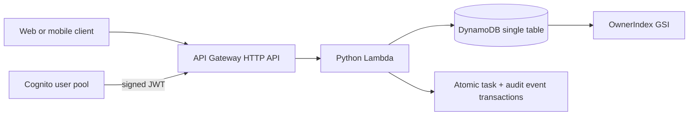

# Enterprise Serverless Task Management Platform

**AWS Lambda · API Gateway · Cognito · DynamoDB · Python 3.12 · IaC · CI**

A secure, multi-tenant task-management backend emphasizing **architecture, database access patterns, concurrency, auditability and testing**. Created as a technical portfolio implementation suitable for an experienced M.S. Computer Science graduate.

> **Verification status:** Source code and local tests are included. This reference system has **not** been deployed to AWS and has **no claimed production traffic or measured performance gains**. Cost and security hardening are required before exposing it to real users.

## Architecture



## Implemented features

- Cognito JWT authorizer on protected API Gateway routes; health route is public.
- Tenant isolation based on signed, immutable custom identity claims.
- Member/admin roles; ordinary members can read/write only their own tasks.
- Multi-tenant single-table DynamoDB layout, efficient owner GSI reads.
- Transactional audit trail committed atomically with task mutations.
- Version-based optimistic concurrency for PATCH and DELETE; stale updates return HTTP 409.
- Strongly consistent reads by ID; eventually consistent paginated GSI queries.
- Request validation and bounded input, output error codes without stacktrace exposure.
- Unit tests and DynamoDB integration-style tests (Moto), GitHub Actions lint and test workflow.

## Project layout

```text
src/taskplatform/
  domain.py         Identity, validation, cursor and error types
  dynamo.py         DynamoDB repository, conditional transactions and pagination
  handler.py        AWS Lambda HTTP routing
  __init__.py
tests/              Domain, API handler and mock-AWS integration tests
docs/               API contract, security model, architectural decision records
template.yaml       AWS SAM infrastructure stack
.github/workflows/ci.yml
```

## Run the tests

Requires Python 3.12:

```bash
python -m venv .venv
source .venv/bin/activate
python -m pip install -r requirements-dev.txt
python -m pytest -q
```

No AWS account or real secrets are required for tests. For optional deployment, install the AWS SAM CLI, configure a dedicated least-privilege AWS account and run `sam validate --lint`, `sam build`, then `sam deploy --guided`. **Deployments can incur AWS charges.**

The stack creates an isolated Cognito user pool. An administrator must provision Cognito users with `custom:tenant_id` and `custom:role` (`member` or `admin`) as immutable attributes. The client must obtain Cognito **ID tokens** carrying these claims. Do not send user-controlled role/tenant headers as authorization.

## API

| Method | Path | Purpose |
|---|---|---|
| GET | `/health` | Public health |
| POST | `/tasks` | Create a task |
| GET | `/tasks?limit=25&cursor=...` | Paginated list |
| GET | `/tasks/{taskId}` | Retrieve accessible task |
| PATCH | `/tasks/{taskId}` | Conditional update, requires `version` |
| DELETE | `/tasks/{taskId}?version=2` | Conditional delete |
| GET | `/audit` | Admin-only tenant audit log |

Example create JSON: `{"title":"Review the architecture","description":"Document tradeoffs"}`.

Example update JSON: `{"status":"IN_PROGRESS","version":1}`.

See [API details](docs/api.md), [system design](docs/architecture.md), [security assumptions](docs/security.md) and [ADR](docs/adr/0001-dynamodb-single-table.md).

## Next production steps

- [ ] Verify deployed Cognito/JWT configuration and access control with real integration tests.
- [ ] Add CloudWatch dashboards, alerting, quotas, budgets and deployment rollback.
- [ ] Implement EventBridge/SQS notifications with an outbox pattern.
- [ ] Perform reproducible load tests and publish p50/p95/p99 and pricing measurements.
- [ ] Add tenant administration, front-end, accessibility checks and incident playbooks.

**Portfolio integrity:** This repository is independent project work, not a claim of employer implementation, a production launch, or unmeasured performance results.