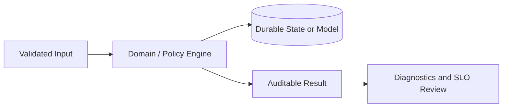

# Architecture: Enterprise Data Warehouse / Incremental ETL

## Context and requirements

Goal: Products changes -> type-2 dimensions -> event-time surrogate lookup -> facts -> reconciled aggregates.

**Functional goals:** event-time SCD2 joins, batch fingerprints, quarantine, referential integrity.

**Quality attributes:** integrity, repeatable execution, clear failure handling, auditability, observability, documented extension points and readable interfaces.

## System boundary

This repository runs without cloud dependencies using a local reference adapter. It isolates core state transformations, contracts and validation from provider-specific integration. For distributed/cloud systems, this is the domain-level design; adapters and runtime infrastructure must be added and validated in a real environment.

## Data flow

## Important tradeoffs

- **Correctness before throughput:** atomic operations, schema guards and deterministic replay are prioritized over speculative speed claims.
- **Operational realism:** source and sink failures must be observable; a live deployment requires tracing, alerting, secrets and infrastructure ownership.
- **Security boundary:** local reference behavior does not replace proper authentication, RBAC, encryption, IAM or network isolation.
- **Cost:** no cloud resource was provisioned. Establish budgets, retention limits and measured usage before rolling out.

## Production target

Move to Snowflake, PostgreSQL or Azure Synapse; add Airflow, partition management, SLA monitoring.

## Declared limitation

Local SQL prototype; no live warehouse/cloud resources or production benchmarks.
